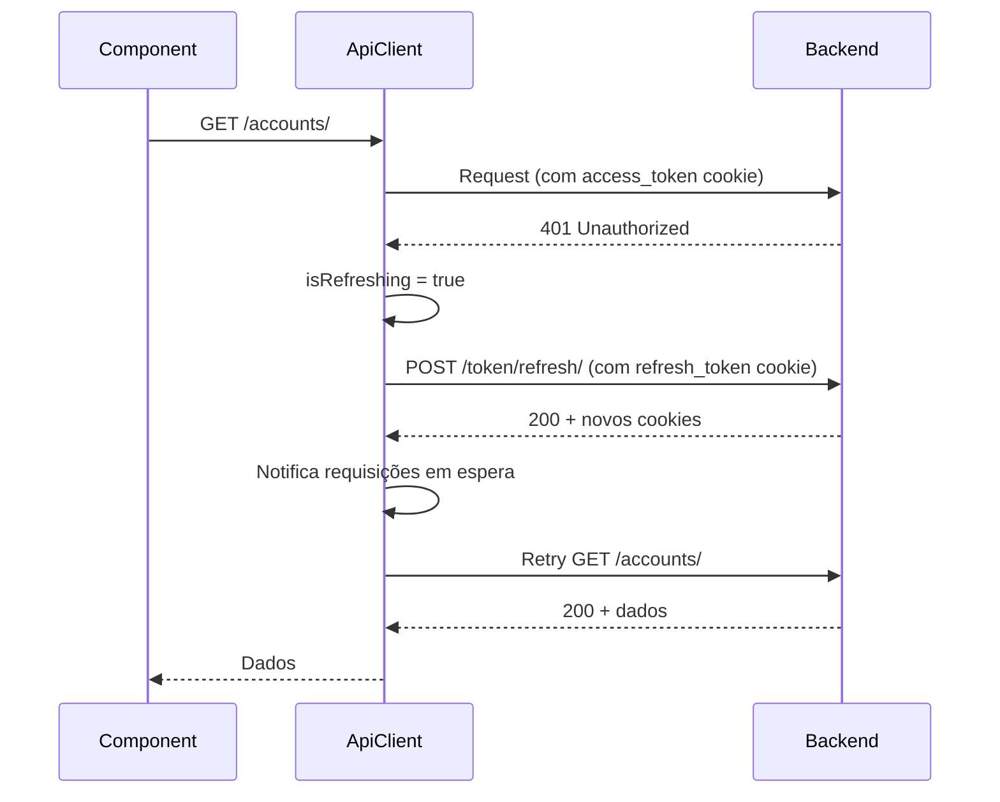

# API Client

## Visão Geral

O Axiom utiliza **Axios** como cliente HTTP base, com interceptors customizados para autenticação automática, refresh de tokens e tratamento de erros centralizado.

## Arquitetura

```
api-client.ts (Singleton)
├── Axios Instance
├── Request Interceptor       # Adiciona auth cookies
├── Response Interceptor      # Token refresh + erro handling
└── HTTP Methods (get, post, put, patch, delete)

services/ (Camada de API)
├── auth-service.ts
├── accounts-service.ts
├── expenses-service.ts
└── ...
```

## api-client.ts - Cliente Base

### Localização

```
src/services/api-client.ts
```

### Classe ApiClient

```typescript
import axios, { type AxiosInstance, AxiosError } from 'axios';
import { API_CONFIG } from '@/config/constants';

class ApiClient {
  private client: AxiosInstance;
  private isRefreshing = false;
  private refreshSubscribers: Array<() => void> = [];

  constructor() {
    this.client = axios.create({
      baseURL: API_CONFIG.BASE_URL,
      headers: {
        'Content-Type': 'application/json',
      },
      withCredentials: true, // ⚠️ CRÍTICO: envia cookies httpOnly
    });

    this.setupInterceptors();
  }

  // ... métodos
}

// Exporta instância singleton
export const apiClient = new ApiClient();
```

## Request Interceptor

Processa requisições antes de enviá-las ao servidor. Loga via `lib/logger.ts` (não `console.log` direto) e remove o `Content-Type` quando o body é `FormData`, para o browser definir o boundary automaticamente.

### Características

- **Cookies automáticos:** `withCredentials: true` envia cookies httpOnly em todas as requisições
- **Timeout:** 30s (`REQUEST_TIMEOUT_MS`)
- **FormData handling:** Remove Content-Type para permitir boundary automático
- **Logging:** via `lib/logger.ts`, suprimido em produção

## Response Interceptor

Trata respostas e erros de forma centralizada. Além do refresh de token, o interceptor de resposta real (`src/services/api-client.ts`) também:

- Em qualquer resposta de sucesso com método != GET, invalida o cache do TanStack Query (`queryClient.invalidateQueries()`) — por isso mutações não precisam chamar `invalidateQueries` manualmente para a maioria dos casos (ver [state_management.md](./state_management.md) e a convenção de query keys no `CLAUDE.md`).
- Detecta a resposta 403 específica da política de dispositivo (web PC-only, `lib/web-access.ts`) e marca `useWebAccessStore` em vez de tratar como `PermissionError` comum.
- Faz retry com backoff exponencial (até `MAX_RETRIES = 3`) em erro de rede e em `429` (respeitando o header `Retry-After` quando presente).
- Se o refresh de token falhar, limpa os dados locais e redireciona para `/login` (`window.location.href`), além de rejeitar com `AuthenticationError`.
- Se a resposta de erro vier como `Blob` (ex.: download que falhou), tenta parsear como JSON antes de repassar ao `handleAxiosError`.

### Fluxo de Token Refresh



### Implementação (resumo)

Endpoints de autenticação (`LOGIN`, `REFRESH_TOKEN`, `VERIFY_TOKEN`, `REGISTER`) nunca disparam refresh. Em um 401 fora desses endpoints, se já houver um refresh em andamento a requisição entra numa fila (`refreshSubscribers`) e é refeita quando ele terminar; senão, o client tenta `POST REFRESH_TOKEN` (cookie httpOnly) e repete a requisição original — falhando, chama `clearTokens()`, redireciona para `/login` e rejeita com `AuthenticationError`.

### Características

- **Refresh automático:** Detecta 401 e tenta refresh do token
- **Fila de requisições:** Enquanto refresh ocorre, outras requisições aguardam
- **Retry automático:** Após refresh bem-sucedido, retry da requisição original
- **Tratamento de erros:** Converte erros HTTP em classes customizadas

## Classes de Erro Customizadas

Definidas em `src/services/api-errors.ts` (não em `api-client.ts`), junto com `handleAxiosError()` — a função que o interceptor de resposta chama para converter o `AxiosError` na classe certa. Só `AuthenticationError` e `ValidationError` são exportadas; `NotFoundError` e `PermissionError` ficam internas ao módulo e são identificadas por `err.name` ou `instanceof` dentro do próprio módulo.

```typescript
export class AuthenticationError extends Error {
  constructor(message: string) {
    super(message);
    this.name = 'AuthenticationError';
  }
}

export class ValidationError extends Error {
  errors: Record<string, string[]>;

  constructor(message: string, errors: Record<string, string[]> = {}) {
    super(message);
    this.name = 'ValidationError';
    this.errors = errors;
  }
}

export class NotFoundError extends Error {
  constructor(message: string) {
    super(message);
    this.name = 'NotFoundError';
  }
}

export class PermissionError extends Error {
  constructor(message: string) {
    super(message);
    this.name = 'PermissionError';
  }
}
```

## Tratamento de Erros

### handleAxiosError (em `api-errors.ts`)

Converte o `AxiosError` na classe certa por status HTTP (400→`ValidationError`, 401→`AuthenticationError`, 403→`PermissionError`, 404→`NotFoundError`, demais→`Error` genérico). Antes disso, trata dois casos especiais: resposta HTML (ex.: erro 500 de proxy, ou `DisallowedHost` do Django) vira uma mensagem amigável em vez de tentar parsear JSON. A extração da mensagem (`formatErrorMessage`) também entende o formato `{error, details: [...]}` usado por alguns endpoints, além do formato padrão do DRF (`{campo: [mensagens]}` e `{detail: "..."}`).

## Métodos HTTP

### GET

```typescript
async get<T = any>(url: string, params?: Record<string, any>): Promise<T> {
  const response = await this.client.get<T>(url, { params });
  return response.data;
}
```

**Uso:**
```typescript
// Sem query params
const accounts = await apiClient.get<Account[]>('/api/v1/accounts/');

// Com query params
const filtered = await apiClient.get('/api/v1/expenses/', {
  category: 'food',
  date_from: '2024-01-01',
});
```

### POST

```typescript
async post<T = any>(url: string, data?: any): Promise<T> {
  if (import.meta.env.DEV) {
    console.log('POST Request:', { url, data });
  }
  const response = await this.client.post<T>(url, data);
  return response.data;
}
```

**Uso:**
```typescript
// JSON data
const newAccount = await apiClient.post('/api/v1/accounts/', {
  name: 'Nubank',
  account_type: 'CC',
  current_balance: '1000.00',
});

// FormData (para arquivos)
const formData = new FormData();
formData.append('name', 'Expense');
formData.append('receipt', file);

const expense = await apiClient.post('/api/v1/expenses/', formData);
```

### PUT

```typescript
async put<T = any>(url: string, data?: any): Promise<T> {
  const response = await this.client.put<T>(url, data);
  return response.data;
}
```

**Uso:**
```typescript
const updated = await apiClient.put('/api/v1/accounts/1/', {
  name: 'Nubank Updated',
  current_balance: '1500.00',
});
```

### PATCH

```typescript
async patch<T = any>(url: string, data?: any): Promise<T> {
  const response = await this.client.patch<T>(url, data);
  return response.data;
}
```

**Uso:**
```typescript
// Atualiza apenas campos específicos
const updated = await apiClient.patch('/api/v1/accounts/1/', {
  current_balance: '2000.00', // Apenas saldo
});
```

### DELETE

```typescript
async delete<T = any>(url: string): Promise<T> {
  const response = await this.client.delete<T>(url);
  return response.data;
}
```

**Uso:**
```typescript
await apiClient.delete('/api/v1/accounts/1/');
```

## Gerenciamento de Tokens

### hasValidToken

```typescript
private tokenValidationCache: { isValid: boolean; timestamp: number } | null = null;
private readonly CACHE_DURATION = 5000; // 5 segundos

public async hasValidToken(): Promise<boolean> {
  // Usa cache se disponível e recente
  if (this.tokenValidationCache) {
    const age = Date.now() - this.tokenValidationCache.timestamp;
    if (age < this.CACHE_DURATION) {
      return this.tokenValidationCache.isValid;
    }
  }

  // Verifica com backend
  try {
    await this.client.post(API_CONFIG.ENDPOINTS.VERIFY_TOKEN);
    this.tokenValidationCache = { isValid: true, timestamp: Date.now() };
    return true;
  } catch {
    this.tokenValidationCache = { isValid: false, timestamp: Date.now() };
    return false;
  }
}
```

### clearTokens

```typescript
public clearTokens() {
  // Limpa apenas cookies não-httpOnly (user_data, user_permissions)
  // HttpOnly cookies (access_token, refresh_token) são removidos pelo backend
  Cookies.remove('user_data');
  Cookies.remove('user_permissions');
  this.tokenValidationCache = null;
}
```

## Services - Camada de API

Cada módulo tem um service que estende `BaseService<T, CreateData, UpdateData>` (`services/base-service.ts`) — não uma classe escrita à mão. `BaseService` já implementa `getAll`, `getAllPaginated`, `getAllPages` (percorre todas as páginas automaticamente), `getById`, `create`, `update` (PUT), `patch`, `delete` e `batchCreate` (cria vários em paralelo).

### Padrão de Service

```typescript
// services/accounts-service.ts
import { BaseService } from './base-service';
import { API_CONFIG } from '@/config/api-config';
import type { Account, AccountFormData } from '@/types';

class AccountsService extends BaseService<Account, AccountFormData> {
  constructor() {
    super(API_CONFIG.ENDPOINTS.ACCOUNTS);
  }
  // Métodos extras específicos do domínio entram aqui
}

export const accountsService = new AccountsService();
```

Para um recurso sem métodos extras, use o helper `createCrudService<T, CreateData>(endpoint)` em vez de declarar uma classe.

### Uso em Componentes

Consumo via TanStack Query (`useQuery`/`useMutation`), nunca `useState`/`useEffect` manual:

```typescript
import { useQuery, useMutation } from '@tanstack/react-query';
import { accountsService } from '@/services/accounts-service';
import { queryClient } from '@/lib/query-client';

function AccountsList() {
  const { data: accounts = [], isLoading } = useQuery({
    queryKey: ['accounts'],
    queryFn: () => accountsService.getAll(),
  });

  const deleteMutation = useMutation({
    mutationFn: (id: number) => accountsService.delete(id),
    onSuccess: () => queryClient.invalidateQueries({ queryKey: ['accounts'] }),
  });

  if (isLoading) return <LoadingState />;

  return (
    <div>
      {accounts.map((account) => (
        <AccountCard
          key={account.id}
          account={account}
          onDelete={() => deleteMutation.mutate(account.id)}
        />
      ))}
    </div>
  );
}
```

Erros de mutação não precisam de tratamento manual de toast na maioria dos casos: `QueryCache.onError` em `lib/query-client.ts` já exibe um toast (debounced).

## Configuração de Endpoints

`API_CONFIG` (com `BASE_URL` e todos os `ENDPOINTS`, ~200 rotas) é definido em **`config/api-config.ts`**; `config/constants.ts` apenas faz `export * from './api-config'` (+ translations + categories) por compatibilidade — importe de `@/config/constants` nos componentes.

`BASE_URL` não é só `VITE_API_BASE_URL`: é calculado em runtime a partir de `window.location.hostname` (evita bloqueio de cookie `SameSite` ao acessar por IP/hostname diferente do configurado), usando `VITE_API_BASE_URL` (fallback `http://localhost:39100`) só para decidir a porta em dev local; em produção (sem porta explícita = via ingress) usa o mesmo origin com path routing.

```typescript
// config/api-config.ts (resumo)
export const API_CONFIG = {
  BASE_URL: getApiBaseUrl(), // ver lógica acima
  ENDPOINTS: {
    LOGIN: '/api/v1/authentication/token/',
    REFRESH_TOKEN: '/api/v1/authentication/token/refresh/',
    ACCOUNTS: '/api/v1/accounts/',
    EXPENSES: '/api/v1/expenses/',
    // ...~200 rotas, uma por recurso
  },
};
```

## Tratamento de Erros em Componentes

```typescript
import { AuthenticationError, ValidationError } from '@/services/api-errors';

const handleSave = async () => {
  try {
    await accountsService.create(formData);
    toast({ title: 'Salvo com sucesso' });
  } catch (err: any) {
    if (err instanceof AuthenticationError) {
      // Usuário não autenticado - já tratado pelo interceptor
      navigate('/login');
    } else if (err instanceof ValidationError) {
      // Mostra erros de validação
      Object.entries(err.errors).forEach(([field, messages]) => {
        form.setError(field, { message: messages.join(', ') });
      });
    } else {
      // Erro genérico
      toast({
        title: 'Erro',
        description: err.message,
        variant: 'destructive',
      });
    }
  }
};
```

## Timeout e Retry

Já implementado nativamente no `api-client.ts` (sem `axios-retry`): timeout de 30s e retry com backoff exponencial (até 3 tentativas) para erro de rede e para `429` — ver "Response Interceptor" acima.

## Boas Práticas

### 1. Sempre use o service, nunca apiClient diretamente

```typescript
// ✅ Bom
const accounts = await accountsService.getAll();

// ❌ Ruim
const accounts = await apiClient.get('/api/v1/accounts/');
```

### 2. Trate erros específicos

`NotFoundError` e `PermissionError` não são exportadas por `api-errors.ts` — para distingui-las de fora do módulo, compare `err.name`:

```typescript
// ✅ Bom
try {
  await accountsService.delete(id);
} catch (err) {
  const name = (err as Error).name;
  if (name === 'NotFoundError') {
    toast({ title: 'Conta não encontrada' });
  } else if (name === 'PermissionError') {
    toast({ title: 'Sem permissão para excluir' });
  } else {
    toast({ title: 'Erro ao excluir' });
  }
}
```

### 3. Use TypeScript para type safety

```typescript
// ✅ Bom - tipos explícitos
const account = await apiClient.get<Account>('/api/v1/accounts/1/');

// ❌ Ruim - tipo any implícito
const account = await apiClient.get('/api/v1/accounts/1/');
```

## Próximos Passos

- **Estado Global:** Veja [gerenciamento-estado.md](./state_management.md)
- **API Endpoints:** Veja [../api/endpoints.md](../api/endpoints.md)
