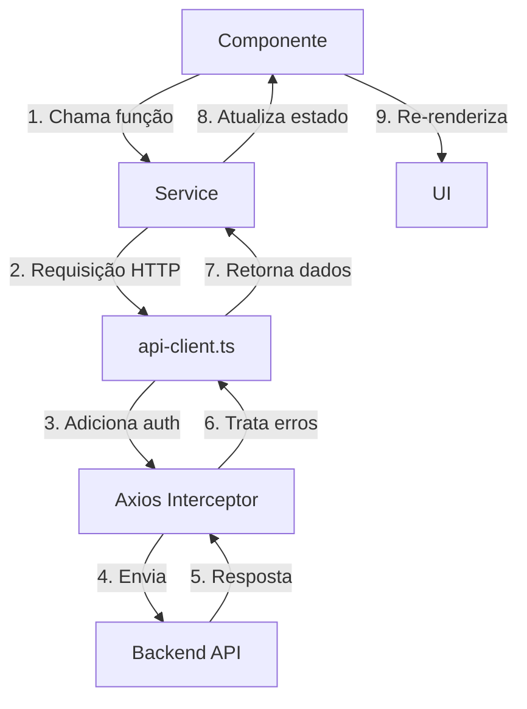

# Estrutura do Projeto Frontend

## Visão Geral

O frontend do Axiom é uma aplicação React + TypeScript moderna, utilizando Vite como bundler e seguindo uma arquitetura modular e escalável.

## Estrutura de Diretórios

```
apps/web/
├── src/
│   ├── assets/              # Recursos estáticos (imagens, ícones)
│   ├── components/
│   │   ├── ui/              # Primitivos (Radix + Tailwind): button, dialog, select, currency-input, number-stepper…
│   │   ├── common/          # Compartilhados: PageContainer, PageHeader, DataTable, EmptyState, PaginatedSlide, ProtectedRoute…
│   │   ├── layout/          # Layout, AdminLayout, PlanningLayout, Header, Sidebar, Breadcrumb, CommandPalette
│   │   ├── providers/       # Context providers
│   │   ├── charts/          # Gráficos (Recharts)
│   │   └── <módulo>/        # Componentes por domínio: accounts, expenses, revenues, credit-cards, transfers,
│   │                        # loans, payables, receivables, vaults, budgets, members, security, library,
│   │                        # personal-planning, workout, nutrition, today-tasks, receipts, tags, notifications…
│   ├── config/              # api-config.ts (endpoints), constants.ts, translations.ts, categories.ts, nav-config.ts…
│   ├── hooks/               # Custom hooks (use-*.ts)
│   ├── i18n/                # react-i18next (locales/pt-BR.json, en-US.json)
│   ├── lib/                 # Utilitários: query-client.ts, form-errors.ts, formatters.ts, validations.ts, animations/…
│   ├── pages/               # Uma página por rota (lazy-loaded); pages/admin/ para o painel admin
│   ├── services/            # Camada de API: api-client.ts, base-service.ts e um *-service.ts por recurso
│   ├── stores/              # Zustand: auth-store, notifications-store, command-palette-store…
│   ├── styles/              # CSS auxiliar (flatpickr)
│   ├── test/                # Setup do Vitest
│   ├── types/               # Tipos TypeScript (index.ts reexporta os arquivos por domínio)
│   ├── utils/               # Utilitários diversos
│   ├── index.css            # Tokens de design, tema e animações
│   ├── App.tsx              # Rotas
│   └── main.tsx             # Entry point
├── public/                  # Arquivos públicos servidos diretamente
├── .storybook/              # Storybook
├── index.html
├── tailwind.config.js
├── vite.config.ts / vitest.config.ts
└── package.json
```

## Organização de Componentes

- **`components/ui/`** — primitivos de baixo nível. Ver [ui_components.md](./ui_components.md). Nunca use `<input type="number|range|color|checkbox">` cru: use `number-stepper`, `decimal-input`, `slider`, `color-picker`, `checkbox`.
- **`components/common/`** — blocos reutilizáveis entre módulos; verifique aqui antes de criar um componente novo.
- **`components/layout/`** — esqueleto da aplicação (sidebar, header, breadcrumb, command palette).
- **`components/<módulo>/`** — formulários, modais e cards específicos de cada domínio (ex.: `components/accounts/AccountForm.tsx`, `AccountDetailModal.tsx`).

## Pages (Rotas)

Todas as páginas protegidas são lazy-loaded em `App.tsx` e envolvidas por `ProtectedRoute`. A lista completa e as regras de acesso estão em [routing.md](./routing.md). Resumo por módulo:

- **Públicas:** `/login`, `/register`, `/forgot-password`, `/reset-password/:uid/:token`, `/verify-email`, `/share/:token`, `/unauthorized`
- **Finanças:** `/`, `/dashboard`, `/accounts`, `/transactions/:tab`, `/expenses`, `/revenues`, `/recurring/:tab`, `/credit-cards/:tab`, `/transfers`, `/loans`, `/bills/:tab`, `/members`, `/budgets`, `/vaults`, `/financial-goals`, `/vaults/simulator`, `/bank-reconciliation/:importId`, `/finance/*` (agenda, analytics, financial-health, calendar, monthly-planner, spending-insights, month-comparison, net-worth, debt-payoff, subscriptions, rules-tags)
- **Segurança:** `/security/dashboard`, `/security/passwords`, `/security/stored-cards`, `/security/stored-accounts`, `/security/archives`, `/security/activity-logs`, `/security/health`
- **Biblioteca / Intellect:** `/library/dashboard`, `/library/books/:tab`, `/library/authors`, `/library/publishers`, `/library/courses`, `/library/skills`, `/library/knowledge-graph`, `/library/intellect-today`, `/library/flashcards`
- **Planejamento** (`/planning/*`, `PlanningLayout`): `today`, `dashboard`, `tasks-goals/:tab`, `daily`, `reflections`, `workout/:tab`, `nutrition/:tab`, `journey`, `week`, `body-metrics`, `weekly-planning`, `emotional-wellness/:tab`
- **Outros:** `/agents`, `/webhooks`, `/settings/profile`, `/admin/*` (config, integrations, logs, users, permissions)

## Services (Camada de API)

Cada service estende `BaseService<T, CreateData, UpdateData>` (`services/base-service.ts`), usa o endpoint de `config/api-config.ts` e é exportado como singleton:

```typescript
class AccountsService extends BaseService<Account, AccountFormData> {
  constructor() {
    super(API_CONFIG.ENDPOINTS.ACCOUNTS);
  }
}

export const accountsService = new AccountsService();
```

Nos componentes, os services são consumidos via TanStack Query (`useQuery` / `useMutation`), nunca chamados diretamente em `useEffect`.

## Types (TypeScript)

Tipos por domínio em `src/types/*.ts` (ex.: `accounts.ts`, `planning.ts`), reexportados por `src/types/index.ts`:

```typescript
import type { Account, PaginatedResponse } from '@/types';
```

## Config

- `config/api-config.ts` — `API_CONFIG.ENDPOINTS` com todas as rotas da API.
- `config/constants.ts` — ponto de importação de traduções/categorias (`translate`, `autoTranslate`, categorias canônicas).
- `config/nav-config.ts` — itens da sidebar; `config/commands.ts` — command palette.

## Convenções de Nomenclatura

- **Componentes e páginas:** PascalCase (`AccountForm.tsx`)
- **Primitivos UI, services, hooks, libs:** kebab-case (`currency-input.tsx`, `accounts-service.ts`, `use-theme.ts`)
- **Pastas:** kebab-case (`credit-cards/`)
- **Variáveis/funções:** camelCase; **constantes:** UPPER_SNAKE_CASE

## Fluxo de Dados



## Padrões de Importação

### Path Alias
O projeto usa `@/` como alias para `src/`:

```typescript
// ✅ Correto
import { Button } from '@/components/ui/button';
import { accountsService } from '@/services/accounts-service';
import type { Account } from '@/types';

// ❌ Evite
import { Button } from '../../../components/ui/button';
```

### Ordem de Imports
1. React e bibliotecas externas
2. Componentes internos
3. Services e stores
4. Types
5. Estilos

```typescript
// 1. React e bibliotecas
import { useState, useEffect } from 'react';
import { useNavigate } from 'react-router';

// 2. Componentes
import { Button } from '@/components/ui/button';
import { AccountForm } from '@/components/accounts/AccountForm';

// 3. Services e stores
import { accountsService } from '@/services/accounts-service';
import { useAuthStore } from '@/stores/auth-store';

// 4. Types
import type { Account, AccountFormData } from '@/types';

// 5. Estilos (se houver)
import './styles.css';
```

## Performance

### Code Splitting
- **Lazy loading** de todas as páginas protegidas
- **Suspense** com fallback de loading

```typescript
const Dashboard = lazy(() => import('./pages/Dashboard'));

<Suspense fallback={<LoadingFallback />}>
  <Dashboard />
</Suspense>
```

### Memoization
- Use `React.memo` para componentes pesados
- Use `useMemo` para cálculos custosos
- Use `useCallback` para funções passadas como props

## Próximos Passos

Para mais detalhes sobre aspectos específicos do frontend:

- **Componentes UI:** [ui_components.md](./ui_components.md)
- **Roteamento:** [routing.md](./routing.md)
- **Estado Global:** [state_management.md](./state_management.md)
- **API Client:** [api_client.md](./api_client.md)
- **Estilização:** [stylization.md](./stylization.md)
